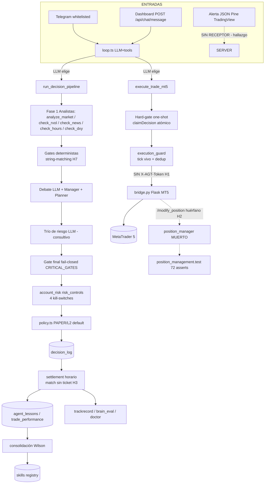
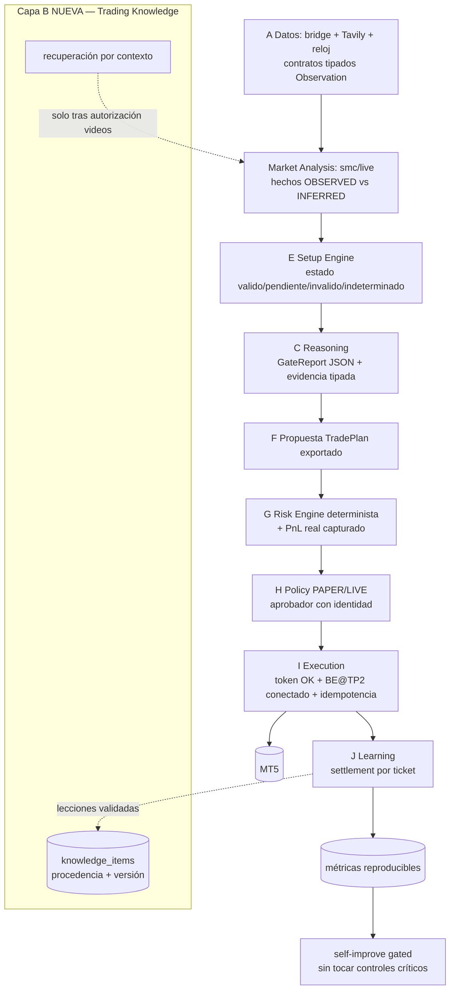

# AGENTE-TRADING — AUDITORÍA ARQUITECTÓNICA Y PLAN DE EVOLUCIÓN

> **Fase 1 (auditoría de solo lectura) + Fase 2 (diseño) + Fase 3 (plan priorizado).**
> La Fase 4 (implementación) queda BLOQUEADA hasta aprobación explícita del usuario.
>
- Fecha de corte: 2026-10-15 · Repositorio: `ALBRA8/AGENTE-TRADING` · Commit auditado: `68a85f2` (main, sincronizado con origin)
- Método: 3 auditorías de exploración en paralelo (pipeline de decisión · datos/SMC/backtest · contratos/persistencia/pruebas) + verificaciones ejecutables independientes (typecheck, suite completa, suites huérfanas, npm audit, escaneo de secretos, confirmación directa de cada hallazgo crítico en código).
- Toda afirmación marcada `[verificado]` fue confirmada ejecutando código o inspeccionando la línea citada. No se modificó ningún archivo funcional (los 4 cambios de modo espurios del working tree fueron restaurados, 0 cambios de contenido).

---

## 1. RESUMEN EJECUTIVO

El núcleo del sistema es **real, honesto y probado**: un detector SMC canónico y determinista (`src/backtest/smc_detector.ts`, reutilizado en vivo por `src/smc/live.ts`), un simulador de backtest sin look-ahead en el P&L con fricción modelada y manifest de reproducibilidad, un pipeline de 6 fases con gates fail-closed, un hard-gate one-shot que garantiza *una decisión = una orden*, un execution guard que re-valida contra tick vivo antes de enviar, 4 kill-switches de cuenta (pérdida diaria 1%, ≤2 posiciones, racha ≤2, ≤3 lotes), y una separación PAPER/LIVE con 4 llaves independientes. La suite determinista suma **333 asserts** y hoy está **100% verde** `[verificado]`.

Sin embargo, la auditoría identifica **3 defectos críticos que rompen o corrompen el ciclo operativo completo** (no la seguridad, sino la funcionalidad y la verdad de los datos):

1. **Ruta de ejecución rota por configuración documentada** `[verificado]`: `bridgeFetch` en `src/config/mt5bridge.ts` nunca envía el header `X-AGT-Token` que `bridge.py` exige (403/401). Ninguna orden podría salir ni en DEMO contra bridge real con token. El E2E usa un mock sin token y es ciego a esto.
2. **Gestión de posición muerta en producción** `[verificado]`: `position_manager.ts` (regla BE@TP2/LOCK_TP1, 72 asserts de test) no tiene ningún llamador productivo; `POST /modify_position` del bridge existe pero nadie lo conecta.
3. **Settlement por proximidad temporal**: el PnL "settled" se casa por `símbolo + timestamp` **sin ticket** → misatribución de resultados entre decisiones del mismo símbolo, contaminando lecciones `OBSERVED`, kill-switch diario y trackrecord.

A ello se suman: kill-switch 1% sub-informado (los cierres reales por SL/TP en MT5 nunca se capturan), tres tablas de SL contradictorias (US30: 80 vs 15 vs ≈15), 26 vulnerabilidades en dependencias de producción (4 críticas, mayormente de `metaapi.cloud-sdk`, que es **vestigial**: 0 imports `[verificado]`), 137 asserts huérfanos fuera de CI, gates de pipeline por string-matching, y deuda backtest concentrada en 3 módulos rotos (29 errores TS reales; el baseline CI de 76 está obsoleto).

**La arquitectura existente NO debe reemplazarse**: ya implementa 8 de las 10 capas objetivo (A, C–J) con la filosofía correcta (fail-closed, hechos vs interpretación, LLM sin autoridad sobre riesgo). Lo que falta es: la capa **B (Trading Knowledge)** —debe diseñarse, no inventarse—, contratos tipados exportados entre capas (7/10 existen pero 3 son privados), y la corrección de los 3 defectos críticos. El plan P0 los ataca sin cambios funcionales de estrategia y sin habilitar LIVE.

---

## 2. ARQUITECTURA ACTUAL COMPROBADA

Mapa de lo existente contra las 10 capas objetivo del mandato. Estado verificado por lectura de código + pruebas.

| Capa objetivo | Implementación actual | Estado | Evidencia |
|---|---|---|---|
| **A. Datos y observabilidad** | `bridge.py` (Flask↔MT5: velas/tick/símbolo, Windows-only), `check_market_hours` (reloj `America/New_York` DST-safe), `check_news` (Tavily real, anti prompt-injection), `check_dxy` (stub honesto UNKNOWN), `check_rvol` (tickVolume + frescura 3×TF), `smc/live.ts` (excluye vela en curso, stale detection) | **OPERATIVO fail-closed** | Toda fuente caída/rancia → UNKNOWN que bloquea EXECUTE (pipeline.ts:602-611) |
| **B. Trading Knowledge** | **NO EXISTE como capa.** Semillas útiles: `skills/registry.ts` (17 skills con métricas reales o null), `agent_lessons` + `consolidation.ts` (EVENT→PATTERN→VALIDATION Wilson→PROMOTION gated), `vectra` parcial (2 tools, embeddings vía NVIDIA real, sin backfill) | **AUSENTE** (semillas presentes) | Diseño requerido, sin cargar conocimiento de videos |
| **C. Reasoning** | `pipeline.ts` (709 LOC): 6 fases, gates deterministas sobre reportes de tools, debate LLM consultivo (2 vetos→WAIT), manager, planner, trío de riesgo | **OPERATIVO con contrato frágil** | Gates deciden por `.includes()` sobre markdown humano (pipeline.ts:228-283) |
| **D. Market Analysis** | `smc_detector.ts` (FVG/swings 5/5/BOS/ChoCh deterministas) + `smc/live.ts` (envoltorio vivo con truthLevels OBSERVED/INFERRED) | **OPERATIVO** — un solo detector canónico, el LLM no detecta nada | live.ts:15-21 importa el detector; duplicación residual con comentarios obsoletos (live.ts:123-160) |
| **E. Setup Recognition** | `isValidSetup` + gates del pipeline | **PARCIAL** | No hay estados explícitos válido/pendiente/inválido/indeterminado exportables; la semántica vive en texto |
| **F. Planning & Decision** | Manager/planner del pipeline → `TradePlan` → `saveDecision` (decision_log con approval_status, consumed_at) | **OPERATIVO** | `TradePlan`/`ManagerVerdict`/`RiskOpinion` definidos pero PRIVADOS (pipeline.ts:41-57) |
| **G. Risk Engine** | `risk_controls.ts` (4 kill-switches con proveedores inyectables, fail-closed) + sizing determinista (SL binding 0.5–1.25× del plan, riesgo heredado de la decisión, MAX_RISK_PCT) | **OPERATIVO con ceguera** | PnL diario solo de `outcome_settled=1` manual; cierres reales MT5 invisibles (sin `/history`) |
| **H. Policy & Autonomy** | `policy.ts` (default PAPER/techo L2, `policy_events` auditado), gobernanza Telegram (`/kill /modo /nivel /techo /aprobar`), `approveDecision` con condiciones | **OPERATIVO** | actor de aprobación es string, no identidad verificada |
| **I. Execution** | `execute_trade_mt5.ts` (hard-gate one-shot, 570 LOC) → `mt5bridge.ts` (`placeOrder` + execution_guard con tick vivo + verificación request-vs-actual) → `bridge.py` (token fail-closed, SL/TP>0 pendientes, magic 234000) | **OPERATIVO PERO ROTO** | Sin header `X-AGT-Token` en el cliente `[verificado]`; BE@TP2 sin llamador `[verificado]` |
| **J. Learning/Eval/Observability** | `settlement.ts` (bucle horario, lock, 8 intentos, lecciones OBSERVED), `trackrecord.ts` (solo settled), `brain_eval.ts`, `doctor.ts` (9 secciones + auto-repair), `observability.ts` | **OPERATIVO con defecto** | Match de PnL sin ticket (settlement.ts:120-131) |

Infraestructura transversal: `sqlite.ts` (11 tablas, WAL, migraciones ad-hoc idempotentes, claim atómico real), `server.ts` (dashboard + rate-limit + DASHBOARD_TOKEN condicional, **sin webhook de TradingView**), `bot/telegram.ts` (whitelist + gobernanza; voz = stub), `nvidia.ts` (tiers quick/deep; mock prohibido con LIVE), `ci.yml` (npm test + typecheck baseline 76).

---

## 3. HALLAZGOS CRÍTICOS

Consolidados de las 3 auditorías + verificación directa. Escala: CRÍTICO (rompe funcionalidad/integridad), ALTO (fiabilidad), MEDIO (consistencia), MENOR (higiene).

| # | Severidad | Hallazgo | Evidencia | Impacto si no se corrige |
|---|---|---|---|---|
| H1 | **CRÍTICO** `[verificado]` | `bridgeFetch` no envía `X-AGT-Token`; `bridge.py` exige token en `/order /cancel /modify_position` (fail-closed). 0 referencias en `src/` | mt5bridge.ts:131-164 vs bridge.py:28-37 | Con la configuración documentada (.env.example), toda escritura al bridge recibe 401/403. Fail-closed (no pierde dinero) pero la ruta de ejecución protegida es inoperante; el E2E con mock bridge sin token no lo detecta |
| H2 | **CRÍTICO** `[verificado]` | `position_manager.ts` (BE@TP2/LOCK_TP1) sin ningún llamador productivo; solo tests | rg: `processOpenPositions` solo en position_manager.ts y tests/ | La protección de posiciones prometida nunca corre; `POST /modify_position` (bridge.py:370) huérfano |
| H3 | **CRÍTICO** | Settlement casa PnL manual por `símbolo + timestamp ≥ created_at` **sin ticket** | settlement.ts:120-131 | Misatribución de resultados entre decisiones del mismo símbolo → contamina lecciones OBSERVED, kill-switch 1% y trackrecord |
| H4 | ALTO | Kill-switch de pérdida diaria sub-informado: no existe captura del PnL realizado por MT5 (SL/TP del broker); sin endpoint `/history` | risk_controls.ts proveedores; bridge.py sin /history | Los cierres reales son invisibles al límite diario; el riesgo se descarga al operador humano |
| H5 | ALTO | Tres tablas de SL contradictorias: `ASSET_SL_TABLE` (US30=80, XAU=12) vs `DEFAULT_SL_PIPS` decorativo (US30=15) vs prompt del planner (US30≈15, XAU≈30) | asset_risk_table.ts:29-43, execute_trade_mt5.ts:78-80, pipeline.ts:379 | Si el LLM omite SL, el fallback (80) cae fuera de la banda 0.5–1.25× del plan (15) → bloqueo garantizado; inconsistencia manual/código |
| H6 | ALTO | 26 vulnerabilidades en deps de producción (4 críticas): crypto-js PBKDF2, axios SSRF ×4 rutas, @grpc ×4 | npm audit `[verificado]` — cadena de `metaapi.cloud-sdk` | Superficie de riesgo en supply chain; la mayoría desaparece eliminando el SDK vestigial |
| H7 | MEDIO | Gates del pipeline por string-matching (`.includes()`) sobre markdown humano | pipeline.ts:228-283 | Degradación silenciosa a UNKNOWN ante cambios de wording (fail-closed, pierde disponibilidad); un reporte nuevo con "✅" podría producir GREEN falso |
| H8 | MEDIO | 137 asserts en 3 suites que NO corren en `npm test` ni CI (memory_skills 46, truth_data 59, backtest_validity 32) — todas verdes hoy `[verificado]` | package.json:11, ci.yml:33-34 | Regresiones silenciosas en memoria, honestidad de datos y validez de backtest |
| H9 | MEDIO | Superficie HTTP: si `DASHBOARD_TOKEN` no está exportado, POSTs abiertos (incl. `/api/chat/message` que ejecuta tools) y GETs con datos operativos (performance, decisions, chat/history); mitigado por bind 127.0.0.1 | server.ts:103-113,163-170,283,347 | Riesgo real solo si se exporta HOST=0.0.0.0 sin token |
| H10 | MEDIO | Deuda backtest: `stress_test.ts` roto en runtime (Trade shape viejo + `baseline` fuera de scope → ReferenceError), `portfolio.ts`/`regime.ts` con NaN; killzone del detector con EST fijo (no DST-safe) vs vivo DST-safe; fuga residual: mitigación FVG escaneada hasta el fin del dataset | stress_test.ts:284-341,535; portfolio.ts:236,241; regime.ts:152-160; smc_detector.ts:106-124,357-360 | Módulos no usables (etiquetados INVALID — honesto), sesgo de selección en FVG, killzone desplazada ~4 meses/año en backtest |
| H11 | MEDIO | El server sirve `public/` (dashboard básico); `public_adaptada/` (Brain/TrackRecord/Doctor/Skills) huérfana; docs la citan como interfaz vigente | server.ts:116 `[verificado]`; PROMPT06.md:23, INFORME_FINAL.md:38 | Doc/código divergentes; el usuario no ve la UI real |
| H12 | MENOR | `metaapi.cloud-sdk` vestigial (0 imports `[verificado]`); telemetría menciona `PIPELINE_GATE` sin efecto; voz Telegram stub; vectra sin backfill SQLite→vector; migraciones ad-hoc sin `user_version`; lock de settlement solo en-proceso; args de tools sin validación runtime (27 casts `as any`); sin idempotencia por client_order_id en bridge; `utcfromtimestamp` deprecado; TP fijo 1:3 en código vs TP R:R del Pine v2 | verificados por los 3 auditores | Higiene; riesgo de drift futuro |

**Lo que NO es hallazgo (comprobado a favor):** claim one-shot atómico real (sqlite.ts:501-509); fail-closed en toda la cadena de datos (3 ejemplos: news sin key, bridge caído, símbolo sin pip-value); PAPER/LIVE separados por 4 llaves independientes; mock LLM prohibido con LIVE; trackrecord/brain_eval solo contabilizan `outcome_settled=1` (nada abierto cuenta como definitivo); secretos por env (escaneo de historial: solo dummies de test `[verificado]`); backtest sin look-ahead en P&L con fricción honesta; detector SMC único compartido backtest/live.

---

## 4. MATRIZ DE COMPONENTES Y ESTADO REAL

| Componente | Ubicación | LOC | Estado | Pruebas | Problema principal | Recomendación |
|---|---|---|---|---|---|---|
| Pipeline 6 fases | src/agent/pipeline.ts | 709 | OPERATIVO | e2e (11 esc.) | gates por string | P1-2 contratos estructurados |
| Loop conversacional | src/agent/loop.ts | 261 | OPERATIVO | indirecta | entrada depende del LLM (soft-contract) | P2-4 webhook determinista |
| Policy | src/agent/policy.ts | 212 | OPERATIVO | e2e 6/7/8 | actor string | P1-8 identidad de aprobador |
| Risk controls | src/agent/risk_controls.ts | 252 | OPERATIVO | risk_smc (34) | ciego a PnL realizado | P0-3 + P1-5 |
| Execution guard | src/agent/execution_guard.ts | 169 | OPERATIVO | e2e | orden manual sin decisión a "gate del tool" | P1-6 exigir decisionId |
| Position manager | src/agent/position_manager.ts | 246 | **MUERTO EN PROD** | 72 asserts | sin llamador | **P0-2** |
| Settlement | src/agent/settlement.ts | 294 | OPERATIVO c/defecto | smoke | match sin ticket | **P0-3** |
| Trackrecord / brain_eval | src/agent/trackrecord.ts, brain_eval.ts | 315/317 | OPERATIVO | smoke | expectancy mixta USD/%; pnl<=0=loss | P3 |
| Self-improve / consolidation | src/agent/self_improve.ts, consolidation.ts | 410/337 | OPERATIVO | memory_skills | gate times_seen≥3 correcto | conservar |
| Doctor / observability | src/agent/doctor.ts, observability.ts | 470/172 | OPERATIVO | memory_skills/smoke | PIPELINE_GATE fantasma | P3 |
| execute_trade_mt5 | src/agent/tools/execute_trade_mt5.ts | 570 | OPERATIVO | risk_smc/e2e | DEFAULT_SL decorativo; TP 1:3 fijo | P1-3, P3 |
| mt5bridge cliente | src/config/mt5bridge.ts | 306 | **ROTO (token)** | — | sin X-AGT-Token | **P0-1** |
| bridge.py | raíz | 580 | OPERATIVO (Windows) | — | sin idempotencia por orden; tick=None→500 | P3 |
| check_* (news/dxy/rvol/hours) | src/agent/tools/ | 256/49/176/222 | OPERATIVO (dxy stub honesto) | truth_data (59) | duplicación reloj NY y TF_MINUTES | P1-4 |
| smc/live.ts | src/smc/ | 555 | OPERATIVO | truth_data/risk_smc | duplicación residual c/comentarios obsoletos | P1-4 |
| smc_detector (backtest) | src/backtest/ | 376 | OPERATIVO | backtest_validity | killzone EST fijo; fuga FVG selección | P1-7 |
| engine/simulator/metrics | src/backtest/ | 465/459/490 | OPERATIVO | backtest_validity | PIP tables duplicadas; maxCandles trunca | conservar + P3 |
| walk_forward | src/backtest/ | 424 | OPERATIVO **no invocable** | backtest_validity | no expuesto en tool | P1-9 |
| stress_test | src/backtest/ | 640 | **ROTO runtime** | 0 | ReferenceError; Math.random sin sembrar | **P1-9** (reconstruir o aislar) |
| portfolio / regime | src/backtest/ | 385/507 | **MUERTO/ROTO** | 0 | Trade shape viejo | P1-9 (idem) |
| sqlite | src/database/ | ~950 | OPERATIVO | smoke | migraciones ad-hoc; lock en-proceso | P1-1 |
| skills / vectra | src/skills/, tools | — | PARCIAL | memory_skills | vectra sin sincronizar | P2-5 |
| server / dashboards | src/server.ts, public*/ | 361/690 | OPERATIVO | — | token condicional; dashboard pobre servido | P1-6, P1-10 |
| telegram | src/bot/ | 379 | OPERATIVO (voz stub) | — | voz TODO | P3 |
| CI | .github/workflows/ci.yml | 44 | OPERATIVO | — | 3 suites fuera; sin lint/audit/build | **P1-5** |

---

## 5. DIAGRAMA DE ARQUITECTURA — ACTUAL Y OBJETIVO

### 5.1 Actual (comprobada)

### 5.2 Objetivo (evolución, sin reemplazo)

Principios de la transición: **reutilizar antes de reconstruir** (el pipeline, policy, guard, kill-switches, settlement, detector SMC y sqlite se conservan); los cambios son de *contratos* y de *conexiones*, no de estrategia; la capa B nace vacía y versionada, y solo recibirá contenido de los videos tras autorización explícita.

---

## 6. FLUJO DE DATOS Y DECISIONES (traza verificada)

1. **Entrada**: Telegram `message:text` → `runAgentLoop` (telegram.ts:300) o dashboard `POST /api/chat/message` (server.ts:294). **No existe receptor del webhook de TradingView** — la alerta JSON del indicador v2 (11-b/11-i) hoy no tiene consumidor (server.ts solo expone `/api/pine/:name` para copiar código).
2. **Pipeline** (el LLM lo invoca por instrucción de prompt — soft-contract): analistas → gates por texto → RED=ABORT sin gastar tokens → debate/manager/planner → trío de riesgo consultivo (JSON ilegible → VETO) → gate final con CRITICAL_GATES fail-closed → policy → `saveDecision` (status EXECUTE/WAIT, approval_status, consumed_at NULL).
3. **Ejecución** (el LLM invoca `executeTradeMT5`): hard-gate — decisión EXECUTE ≤15 min, más reciente del símbolo, no consumida, dirección/SL/riesgo vinculados, `claimDecision` atómico → sizing determinista (tick real → symbol_info → tabla → rechazo) → `MT5Bridge.placeOrder` → execution_guard re-valida kill-switch/LIVE/whitelist/volumen/SL-TP/tick fresco/spread/cuenta → POST /order (bridge exige token + SL/TP>0) → verificación request-vs-actual → `saveOrder`. Timeout → decisión ya consumida, estado "unknown", **sin reintentos** (puede quedar orden sin decisión; nunca decisión duplicada).
4. **Seguimiento**: settlement horario — decisiones EXECUTE vencidas → busca orden → PnL manual (match sin ticket, H3) o flotante MT5 o expira tras 8 intentos → lección `truthLevel='OBSERVED'` → consolidación EVENT→PATTERN→VALIDATION (Wilson 95%) → PROMOTION gated auditada.
5. **Evaluación**: trackrecord/brain_eval solo sobre `outcome_settled=1` — ninguna operación abierta cuenta como resultado definitivo.

**Lacuna de flujo clave**: la señal del indicador Pine (que el usuario opera manualmente) no alimenta el pipeline; el puente natural (webhook → propuesta estructurada en F, sin ejecución automática) es la tarea P2-4 y requiere decisión de diseño aprobada.

---

## 7. PROBLEMAS DE INTEGRACIÓN Y CONTRATOS ENTRE CAPAS

Estado de las 10 estructuras contractuales del mandato:

| Contrato | Estado actual | Qué falta |
|---|---|---|
| 1. Observación de mercado | `LiveAnalysis` (smc/live.ts:51) + velas `Candle` (mt5bridge.ts) | Cubierto; renombrar/agrupar en contrato explícito |
| 2. Evidencia y procedencia | **ANÓNIMO**: `Record<string, unknown>` y `evidence_json` TEXT | Tipo `Evidence` con fuente, timestamp, hash, truthLevel |
| 3. Resultado de análisis | Reportes como **strings** en `reports_json` | `AnalysisReport` tipado por tool |
| 4. Estado del conocimiento | — | Esquema `knowledge_items` (capa B, vacía) |
| 5. Candidato a setup | `SMCSetup` (backtest) / heurístico en vivo | Estados explícitos: válido/pendiente/inválido/indeterminado |
| 6. Propuesta de operación | `TradePlan` definido pero **PRIVADO** (pipeline.ts:48) | Exportar + versionar |
| 7. Evaluación de riesgo | `AccountRiskSnapshot` ✅ + `RiskOpinion` privado | Exportar RiskOpinion |
| 8. Decisión de política | `ExecutionVerdict`/`PolicyState` ✅ + `policy_events` | Añadir actor con identidad |
| 9. Solicitud/resultado de ejecución | `MT5OrderRequest`/`MT5OrderResult` ✅ | `client_order_id` para idempotencia |
| 10. Registro de resultado | `DecisionRow` ✅ + `trade_orders` | `ticket` obligatorio para settlement |

Problemas transversales de integración: (a) el pipeline consume **texto humano** de los tools en vez de sus funciones puras ya exportables (`evaluateMarketHours`, `computeRvol`, `LiveAnalysis.dataStale`) — duplicación de semántica; (b) `Trade` del backtest cambió de shape y 3 módulos legacy quedaron desalineados (stress/portfolio/regime) — el tipo es el contrato y nadie lo vigila fuera de `src/`; (c) args de tools llegan del LLM con `as unknown as X` sin validación runtime (sin zod) — JSON malformado produce undefined silencioso en campos críticos; (d) tablas PIP_SIZE/PIP_VALUE y reloj NY duplicados entre backtest y live con riesgo de divergencia ya documentado; (e) 3 tablas de SL (H5) como anti-patrón de "fuente única de verdad".

---

## 8. SEGURIDAD, RIESGO Y EJECUCIÓN

**Separación PAPER/LIVE** — 4 llaves independientes `[verificado por auditoría + e2e rechazos 7/8]`: (1) policy default PAPER con techo L2; LIVE exige `/techo 4` + `LIVE_TRADING=true` + decisión `approved` (policy.ts:156-184); (2) sin LIVE_TRADING el tool nunca envía nada (calcula y guarda status `demo`, execute_trade_mt5.ts:443-481); (3) execution_guard re-exige `liveTradingEnv && verdict.allowed` en el envío (execution_guard.ts:79-86); (4) el arranque aborta si LIVE sin DASHBOARD_TOKEN (server.ts:350-354) y el mock LLM se rechaza con LIVE (nvidia.ts:138-145). **Ninguna mejora propuesta habilita LIVE implícitamente.**

**Controles deterministas sobre el LLM**: precios derivados del tick real y re-validados (tolerancia 2×SL, spread); `riskPercentage` del LLM ignorado — el riesgo se hereda de la decisión y se acota a MAX_RISK_PCT; one-shot atómico con `releaseDecision` si la orden falla; kill-switch re-evaluado en pipeline Y en el envío. El LLM es consultivo: no aprueba riesgo, no inventa precios, no salta políticas. Matiz aceptado: puede *no* llamar al pipeline, pero el hard-gate hace inofensivo cualquier intento de ejecución sin decisión.

**Secretos**: todo por env; escaneo del código actual = solo dummies de test; escaneo del historial git = solo dummies `[verificado]`. Pendiente humano documentado (C1): rotar la Tavily key expuesta en una sesión externa y revocar el token de GitHub pegado en el chat (`ghp_zTpB…`) — fuera del alcance del código.

**Superficie HTTP** (H9): POSTs protegidos solo si `DASHBOARD_TOKEN` está exportado; GETs de datos operativos abiertos por diseño; mitigación vigente: bind 127.0.0.1 + rate-limit 60/min + aborto de boot en LIVE sin token. Recomendación P1-6: token fail-closed (si el modo LIVE está activo, exigirlo siempre) y mover `/api/performance` y `/api/agent/decisions` detrás del token.

**Ejecución — idempotencia y estados inciertos**: una decisión = una orden (claim atómico + dedup por `trade_orders`); timeouts quedan en "unknown" sin reintento (dirección segura); bridge con token fail-closed y SL/TP obligatorios en pendientes; verificación request-vs-actual del fill. Déficit real: sin `client_order_id` a nivel orden (reintento manual duplicaría), sin captura de cierres del broker (H4), y BE@TP2 no corre (H2).

**Fail-closed verificado (3 ejemplos)**: news sin TAVILY_API_KEY → UNKNOWN → bloquea EXECUTE; bridge caído → `evaluated=false` → UNKNOWN en pipeline y en guard; símbolo sin pip-value → rechazo del sizing. Añadidos: feed rancio (>3×TF) → RVOL/price_feed UNKNOWN; símbolo sin política horaria → UNKNOWN.

---

## 9. CI, PRUEBAS Y DEUDA TÉCNICA

**Verificación ejecutada hoy** `[verificado]`:

| Verificación | Resultado |
|---|---|
| `npm test` (smoke 52 + risk_smc 34 + position_management 72 + e2e 38) | **exit 0 — 196 asserts verdes** |
| Suites huérfanas (memory_skills 46 + truth_data 59 + backtest_validity 32) | **exit 0 — 137 asserts verdes, PERO fuera de CI** |
| Total suite determinista | **333 asserts, 0 red externa, 0 LLM real, Date congelado en e2e** |
| `npx tsc --noEmit` | **29 errores** (stress_test 17, regime 8, portfolio 4) — el baseline CI de 76 está obsoleto (la deuda bajó; hay margen de 47) |
| `npm audit --omit=dev` | **26 vulnerabilidades** (4 críticas, 9 altas, 8 moderadas, 5 bajas) — la mayoría en la cadena de `metaapi.cloud-sdk` (vestigial) |
| Escaneo secretos en código y en `git log -p --all` | Solo dummies de test (`nvapi-*-not-real`, `tvly-e2e-dummy`) |
| Versiones | Dev: Node 24.21 / npm 11.19. CI: Node 20. Sin `engines` en package.json. @types/node ^22 |

**CI actual** (ci.yml): `npm ci` → `npm test` → typecheck con gate `≤76`. **Faltan**: las 3 suites huérfanas (fix de 1 línea en package.json:11), lint (no existe eslint), `npm audit`, `npm run build` (el emit de tsc nunca se verifica), pin de versión Node.

**Deuda técnica concentrada**: (1) 29 errores TS en 3 módulos backtest legacy con shape de `Trade` viejo — uno crashea en runtime (stress_test: ReferenceError garantizada por `baseline` fuera de scope); (2) 27 casts `as any`/`ts-ignore` en src (borde de tools y sqlite); (3) `tsconfig` strict pero sin `noUncheckedIndexedAccess`, y `include: ["src/**/*"]` deja los tests fuera del typecheck; (4) duplicaciones documentadas (PIP tables, reloj NY, TF_MINUTES) y contradictorias (SL ×3). **No se declara la auditoría de backtest aprobada para operar**: el motor es válido y reproducible (manifest §7, WFA con anti-solape, testeado), pero stress/portfolio/regime no son usables y el flujo completo live↔MT5 no es ejecutable en este entorno (bridge Windows-only) — esa verificación permanece PENDIENTE y así consta.

---

## 10. PLAN DE EVOLUCIÓN PRIORIZADO

Formato por tarea: objetivo · archivos · dependencias · riesgos · pruebas · criterio de aceptación. La Fase 4 NO comienza sin aprobación.

### P0 — Seguridad, integridad y bloqueos críticos
- **P0-1 · Token del bridge en el cliente**: enviar `X-AGT-Token: process.env.BRIDGE_TOKEN` en `bridgeFetch`. Archivos: `src/config/mt5bridge.ts` (+ `.env.example` nota). Riesgo: bajo (fail-closed se mantiene). Pruebas: e2e con mock bridge que EXIJA el header (nuevo caso negativo sin token → rechazo). Aceptación: e2e verde con token requerido; sin token configurado el cliente falla con mensaje claro antes de enviar.
- **P0-2 · Conectar BE@TP2/LOCK_TP1**: executor concreto (`POST /modify_position`) invocado desde el bucle de mantenimiento (index.ts) para posiciones con `decision_id`. Archivos: `src/agent/position_manager.ts` (executor), `src/index.ts`/maintenance, `src/config/mt5bridge.ts`. Riesgo: medio — tocar solo posiciones con decisión propia (magic+decisionId), nunca manuales. Pruebas: integración con mock bridge + los 72 asserts existentes. Aceptación: posiciones DEMO con decisión reciben BE al tocar TP2 en el mock; posiciones sin decisión intactas.
- **P0-3 · Settlement por ticket**: prohibir el match por proximidad; exigir ticket (orden demo guardada con ticket real o marcada `simulated` y liquidada por estimación explícita, nunca `bridge_unavailable` falso). Archivos: `src/agent/settlement.ts`, `src/database/sqlite.ts` (columna ticket NOT NULL en nuevos registros), `bridge.py` (opcional `/history`). Riesgo: medio (migración de datos históricos → marcar legacy). Pruebas: smoke settlement con 2 órdenes mismo símbolo → sin cross-match. Aceptación: 0 lecciones OBSERVED con PnL de otra decisión.
- **P0-4 · Higiene de secretos (ACCIÓN HUMANA)**: rotar Tavily key, revocar token GitHub del chat, decidir purga de historial (reescribir historia es irreversible → requiere aprobación explícita). Aceptación: claves viejas muertas en los proveedores.

### P1 — Corrección, consistencia y fiabilidad
- **P1-1 · Migraciones versionadas + concurrencia**: `PRAGMA user_version`, `busy_timeout`, lock de settlement a nivel SQL (patrón claim). Archivos: sqlite.ts, settlement.ts.
- **P1-2 · Contratos estructurados**: exportar `TradePlan`/`ManagerVerdict`/`RiskOpinion`; los tools devuelven `GateReport` JSON además del markdown; pipeline consume el JSON (fallback a UNKNOWN si falta). Archivos: pipeline.ts, check_*.ts, analyze_market.ts, types (nuevo `src/agent/contracts.ts`). Aceptación: gates sin `.includes()` de texto humano; e2e verde.
- **P1-3 · Fuente única de SL**: eliminar `DEFAULT_SL_PIPS` decorativo y la SL del prompt del planner; una sola tabla (`asset_risk_table.ts`) extendida a NAS/GBPJPY/BTC alineada con el Pine. Aceptación: rg encuentra 1 sola definición; e2e verde.
- **P1-4 · Deduplicar**: reloj NY y TF_MINUTES en un módulo común; limpiar comentarios obsoletos y código muerto de smc/live.ts. Aceptación: 1 reloj, 1 tabla TF.
- **P1-5 · CI completa**: cablear 3 suites huérfanas en `npm test`; añadir `npm run build`, `npm audit --omit=dev --audit-level=high` (gate), eslint mínimo; `engines` en package.json; baseline tsc 76→29 (meta 0 en P1-9). Aceptación: CI rojo ante regresión en cualquiera de las 7 suites.
- **P1-6 · HTTP fail-closed**: DASHBOARD_TOKEN exigido para POSTs y para GETs con datos operativos cuando el server no esté en 127.0.0.1; endpoint `POST /api/chat/message` siempre con token. Aceptación: sin token → 503 explícito.
- **P1-7 · Backtest honesto DST y sin fuga**: killzone con `America/New_York` Intl; mitigación FVG evaluada solo con velas ≤ entrada. Archivos: smc_detector.ts, metrics.ts. Aceptación: backtest_validity verde + test nuevo de ventana DST.
- **P1-8 · Aprobador con identidad**: `approveDecision` registra actor verificado (Telegram user id de la whitelist o token dashboard), no string libre. Aceptación: policy_events con actor verificable.
- **P1-9 · Deuda backtest**: decisión pendiente (ver §12): reconstruir stress/portfolio/regime contra el `Trade` actual o aislarlos fuera del barrel + eliminarlos de docs; exponer walk_forward en run_backtest_pro; bajar baseline a 0. Aceptación: tsc 0 errores o módulos eliminados del build.
- **P1-10 · Dashboard y docs**: servir `public_adaptada` (o eliminarla) y corregir PROMPT06/INFORME_FINAL/BACKTEST_PRO (portfolio/WFA "listos para usar" → estado real). Aceptación: lo que sirve el server = lo que dicen los docs.

### P2 — Preparación de conocimiento, razonamiento y evaluación
- **P2-1 · Capa B (esquema vacío)**: tabla `knowledge_items` (id, fuente, versión, contenido estructurado, estado draft/validated, procedencia, hash) + CRUD interno. **NO se carga contenido de videos.** Aceptación: esquema + tests de integridad sin datos.
- **P2-2 · Evidencia tipada**: contrato `Evidence` (fuente, timestamp, hash de datos, truthLevel) escrito por cada tool; trazabilidad decision_id → evidencias. Aceptación: toda decisión nueva tiene ≥1 evidencia consultable.
- **P2-3 · Setup Engine (interfaz)**: wrapper sobre smc_detector con estados `VALID/PENDING/INVALID/UNKNOWN` y condiciones cumplidas/faltantes. Sin reglas nuevas de entrada. Aceptación: unit tests sobre estados con velas sintéticas.
- **P2-4 · Webhook TradingView (decisión de diseño)**: receptor `POST /api/tv/webhook` (token propio) que valida el JSON del Pine v2 y crea una PROPUESTA (nunca ejecuta) para el pipeline. Requiere aprobación del usuario (nueva superficie de entrada). Aceptación: propuesta creada con trazabilidad, 0 órdenes directas.
- **P2-5 · Memoria vectorial**: sincronizar SQLite→vectra (backfill) o congelar y marcar experimental; quitar `@ts-ignore`. Aceptación: searchMarketMemory sobre datos completos o deshabilitado honestamente.

### P3 — Mejoras posteriores
Voz Telegram; feed DXY real; idempotencia bridge (`client_order_id`); captura de cierres MT5 (`/history` o polling) para kill-switch completo; eliminar `metaapi.cloud-sdk` (+ la mayoría de las 26 vulns); `utcfromtimestamp` → `datetime.fromtimestamp`; TP del bot alineado con los R:R del Pine; expectancy en una unidad; duraciones en minutos; `noUncheckedIndexedAccess`; zod en el borde de tools; eliminar `PIPELINE_GATE` de telemetría; unificar `public/` vs `public_adaptada/`.

---

## 11. ARCHIVOS CONCRETOS QUE SE MODIFICARÍAN

| Fase/Tarea | Archivos | Tipo de cambio |
|---|---|---|
| P0-1 | `src/config/mt5bridge.ts`, `tests/e2e_pipeline.ts` (mock exige token), `.env.example` | código + test |
| P0-2 | `src/agent/position_manager.ts`, `src/index.ts` (o módulo maintenance), `src/config/mt5bridge.ts` | código nuevo conector |
| P0-3 | `src/agent/settlement.ts`, `src/database/sqlite.ts`, `tests/smoke_phases.ts` | lógica + migración |
| P1-1 | `src/database/sqlite.ts`, `src/agent/settlement.ts` | migraciones/lock |
| P1-2 | `src/agent/contracts.ts` (nuevo), `pipeline.ts`, `check_*.ts`, `analyze_market.ts` | refactor contratos |
| P1-3 | `src/config/asset_risk_table.ts`, `execute_trade_mt5.ts`, `pipeline.ts` (prompt) | deduplicación |
| P1-5 | `package.json`, `.github/workflows/ci.yml`, `eslint.config.mjs` (nuevo) | CI |
| P1-7 | `src/backtest/smc_detector.ts`, `metrics.ts`, `tests/backtest_validity.test.ts` | corrección sesgo |
| P1-9 | `src/backtest/stress_test.ts` / `portfolio.ts` / `regime.ts`, `run_backtest_pro.ts`, `ci.yml` | reconstrucción o aislamiento |
| P2-1/2 | `src/database/sqlite.ts`, `src/agent/contracts.ts`, tools | esquema + tipos |
| P3 | varios | higiene |

---

## 12. CRITERIOS DE ACEPTACIÓN Y RIESGOS PENDIENTES

**Criterios del mandato — cumplimiento:**
1. ✅ Mapa verificable de la arquitectura actual (§2, §4, §5.1 — con evidencia archivo:línea).
2. ✅ Auditoría de calidad, seguridad, riesgo y ejecución (§3, §8).
3. ✅ Diagnóstico real de CI y pruebas (§9 — ejecutado hoy, no declarativo: 196+137 asserts verdes, tsc 29, audit 26 vulns).
4. ✅ Arquitectura objetivo compatible con lo existente (§5.2 — evolución, no reemplazo; 8/10 capas ya existen).
5. ✅ Contratos definidos entre capas (§7 — 10 estructuras con estado y qué falta).
6. ✅ Plan priorizado con archivos y criterios de aceptación (§10, §11).
7. ✅ Riesgos abiertos y decisiones que requieren aprobación (abajo).
8. ✅ Separación explícita entre lo que existe, lo propuesto y lo no implementado (§4, §10; capa B vacía por diseño).

**Verificaciones NO completadas (constan como pendientes, no como aprobadas):**
- E2E contra bridge.py + MT5 real (Windows-only; este entorno es Linux) — la ruta de ejecución física no puede validarse aquí.
- `npm run build` (emit) no verificado ni en CI ni localmente.
- Backtest estadístico del Pine v2 (PF/WinRate/MaxDD) — pendiente de que el usuario corra `zarus30_v2_strategy.pine`; sin ese número NO se declara rentabilidad de nada.

**Riesgos abiertos:**
- H1/H2/H3 activos: la ruta operativa completa (orden→protección→liquidación veraz) NO es confiable hoy en producción real, aunque es segura (fail-closed).
- Kill-switch 1% parcialmente ciego hasta P0-3 + captura de cierres.
- Deps con 26 vulnerabilidades (4 críticas) hasta eliminar metaapi / `npm audit fix`.
- vectra y memoria semántica sin sincronizar: no usar para decisiones.
- Node 24 dev vs Node 20 CI: diferencia no cubierta por pruebas hasta pin/engines.

**Decisiones que requieren aprobación humana antes de actuar (irreversibles o de impacto operativo):**
1. Rotar Tavily key y revocar token GitHub del chat (acción externa inmediata, sin riesgo).
2. Purgar/reescribir historial git para eliminar la Tavily key antigua (irreversible — requiere decisión).
3. stress_test/portfolio/regime: ¿reconstruir contra `Trade` actual o eliminarlos del repo? (afecta alcance de P1-9).
4. Servir `public_adaptada` como dashboard oficial o eliminarla (afecta UX del operador).
5. P2-4 webhook TradingView: crear la superficie de entrada nueva (con token) o mantener el flujo solo conversacional.
6. Aprobar el inicio de la **Fase 4** (implementación incremental P0 → P1 → P2), en ese orden, con commit y pruebas por tarea.

**Resultado esperado cumplido**: el sistema queda caracterizado con evidencia — no se reemplaza nada, la capa de conocimiento se prepara vacía y versionada, los 3 defectos críticos tienen corrección acotada con pruebas, y LIVE permanece deshabilitado bajo las 4 llaves existentes.
